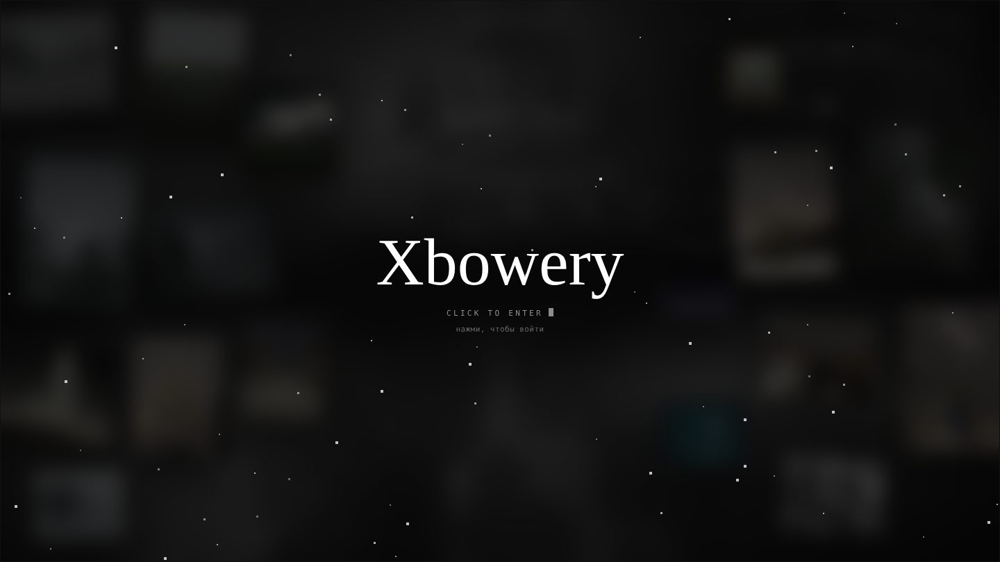
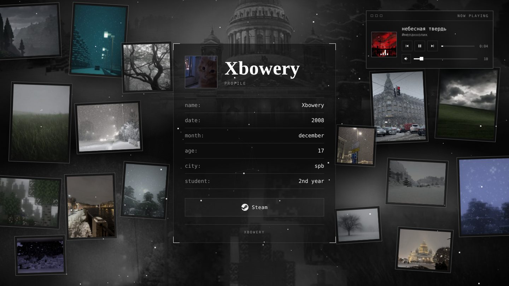
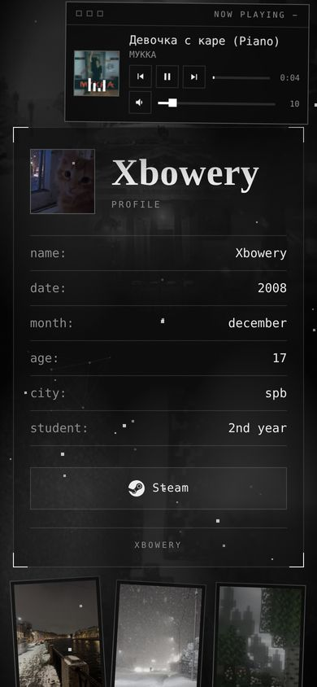

<div align="center">



# Xbowery

**Моя визитка в интернете: одна страница, на которой идёт снег, играет музыка и плавают фотки зимнего Питера.**


</div>

---

Захотелось ссылку в био, за которой не скучный список кнопок, как у Linktree, а что-то своё. Чтобы человек открыл, а там снег, тихая музыка и ощущение, что зашёл ко мне в комнату зимним вечером. Получилась вот такая штука.

## Как это выглядит

<table>
<tr>
<td width="70%"></td>
<td width="30%"></td>
</tr>
<tr>
<td align="center"><sub>на компе</sub></td>
<td align="center"><sub>на телефоне</sub></td>
</tr>
</table>

## Что тут происходит

**Снег как в Майнкрафте.** Квадратные пиксельные хлопья, лёгкий ветер. Его можно разгонять курсором, кликом выбить целое облачко, а часть снежинок оседает на верхнем краю карточки и через полминуты тает. Если провести мышкой по этой шапке, её сдует.

**Фотки сами сменяются.** Вокруг карточки висит 16 рамок, они покачиваются и слегка уезжают за курсором. Каждая раз в 7–15 секунд мягко меняет снимок. Всего фото 19, и одно и то же никогда не окажется в двух рамках сразу. Вот этот баг я ловил дольше всего: скрытые на телефоне рамки тихо держали у себя картинки, свободных не хватало, и вылезали дубли.

**Плеер в углу.** Восемь треков в случайном порядке, громкость стартует с 10%, ползунок запоминает, что ты выбрал. На телефоне плеер тоже висит в углу, а по нажатию на шапку сворачивается в полоску.

**Экран входа.** Браузеры не дают сайту включать звук, пока ты ничего не нажал. Поэтому сначала тёмная вуаль с ником и «click to enter», и музыка стартует ровно в момент клика. Со стороны выглядит как автозапуск.

**Возраст считает себя сам.** Цифра меняется 6 декабря в 7:00 по Москве, причём по московскому времени, даже если сайт открыли в Токио.

<details>
<summary><b>Мелочи, на которые ушло больше времени, чем хотелось бы</b></summary>

<br>

- На iPhone обычный способ менять громкость не работает вообще, и музыка играла бы на полную. Пришлось пропускать звук через Web Audio, тогда ползунок слушается.
- На телефоне при прокрутке прячется адресная строка, браузер считает это изменением размера окна, и снег с точками фона каждый раз раскидывался заново. Теперь они просто подстраиваются под новую высоту.
- Слой плёночного зерна дёргается для эффекта, и когда он съезжал, сбоку открывалась серая полоса. Лечится тем, что слой больше экрана.
- Если отключить JavaScript, экран входа просто не появится и не запрёт сайт.
- Картинки нельзя утащить мышкой, а правая кнопка меню не открывает.

</details>

## Запустить у себя

```bash
git clone https://github.com/maks3592/xbowery.git
cd xbowery
python -m http.server 8000
```

Потом открыть `http://localhost:8000`. Можно и просто дважды кликнуть по `index.html`, но через локальный сервер всё ведёт себя ровно как на хостинге.

## Как устроено

```
index.html            вся страница: разметка, стили и скрипты в одном файле
assets/
  avatar.jpg          аватарка в карточке
  steam.jpg, tg.jpg   аватарки для превью при наведении на кнопки
  bg/                 фоновый коллаж и одно видео вместо тяжёлой гифки
  photos/             19 фото для плавающих рамок
  music/              сюда кладутся треки и обложки (в репозиторий не входят)
  og.jpg              картинка, которая показывается, когда кидаешь ссылку в чат
docs/                 скриншоты для этого README
```

Всё, что может захотеться поменять, лежит в самом начале скрипта в `index.html`:

| Что | Где | Зачем |
|---|---|---|
| `ENTER_SCREEN` | `true` / `false` | включить или убрать экран входа |
| `SHOW_TG`, `TG_USER` | флаг и юзернейм без `@` | вернуть кнопку Telegram |
| `STEAM_ID` | ник из ссылки на профиль | куда ведёт кнопка Steam |
| `BIRTH_*` | год, месяц, день, час по МСК | когда прибавлять год к возрасту |
| `TRACKS` | список в блоке плеера | какие треки играют |
| `POOL` | список в блоке фото | какие фотки крутятся в рамках |

Без сборщиков, без npm, без фреймворков. Одна страница, которую можно открыть хоть с флешки.

## Музыка

Самих треков в репозитории нет: это чужая музыка, и раздавать её отсюда я не хочу. Плеер ждёт файлы в `assets/music/`, а их названия, исполнителей и обложки берёт из списка `TRACKS` в `index.html`. Положил туда свои mp3, поправил список, и всё заиграло. Если папка пустая, плеер честно пишет, что музыка не загрузилась, и больше ничего не ломается.

---

<div align="center">
<sub>сделано зимой в Петербурге · xbowery</sub>
</div>
